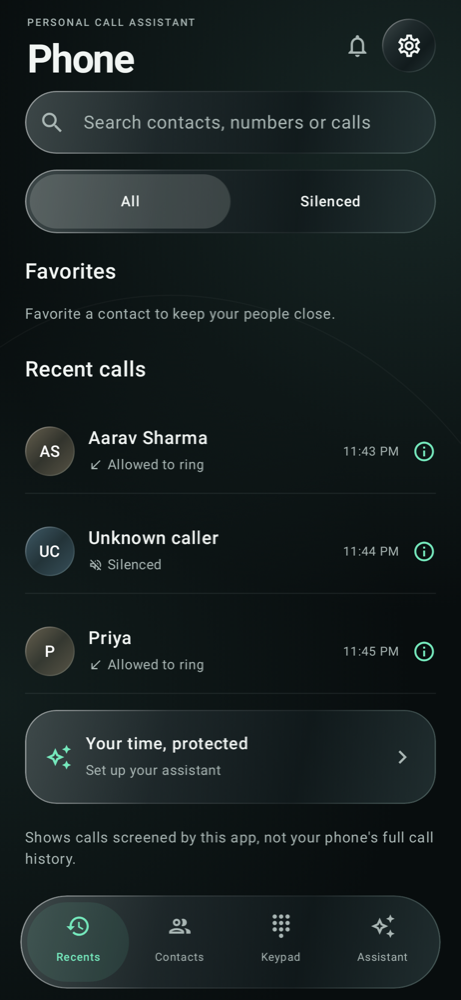
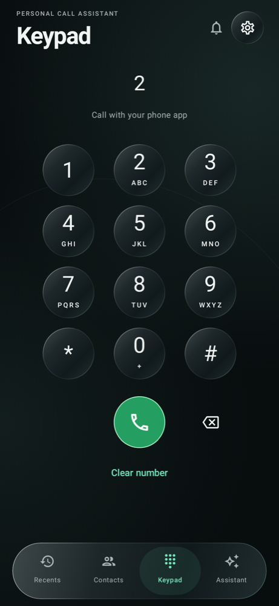
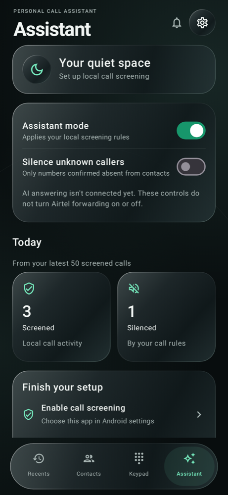
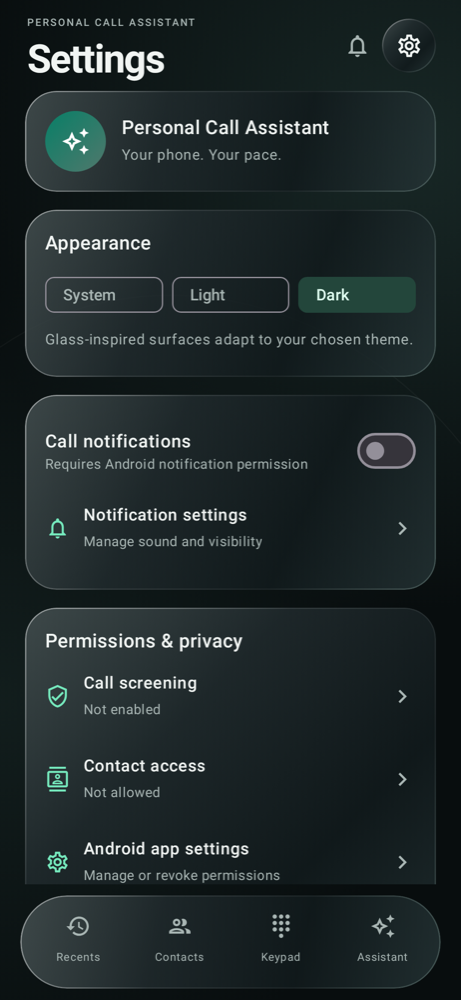

# Member 1 — Android UI and user settings

## Screens
- **Recents:** searchable/filterable local screening history, favorite contacts, assistant-status card, and call detail dialogs. The history is not the device's full call log.
- **Contacts:** permission-aware address book, search, favorites, and per-number rules. Permission errors never produce fabricated contacts.
- **Keypad:** circular number buttons, long-press 0 for +, deletion/clear, and a call button that opens the user's Android dialer.
- **Assistant:** master local-rule switch, unknown-caller silencing, quiet-hours start/end and weekdays, and setup prompts.
- **Settings:** system/light/dark appearance, notification preferences, Android permission links, history deletion, connection status, and Member 2 diagnostics.
- **Notification inbox:** displays recent local screening events, explicitly distinguished from future AI summaries.

## Visual implementation
Jetpack Compose and Material 3, with custom translucent gradient cards, highlights, large headings, a floating four-tab capsule navigation bar, circular keypad buttons, and charcoal backgrounds with emerald accents. The UI is inspired by iPhone Phone/Liquid Glass; it does not embed Apple fonts, assets, branding, or native iOS effects. Settings is opened with the gear in the header. New installations default to Dark; existing explicitly saved appearance preferences are preserved. The background is rendered locally. There are no external images or network calls.

## State and behavior
AssistantPreferences persists appearance, notifications, weekday/time schedules, favorites, and contact rules in app-private SharedPreferences. TelephonyStore retains the existing master/silence flags and the last 50 screening events. Contacts are read with permission from the Android provider and are not copied wholesale into preferences.

Rules apply only when the master switch is on and the schedule contains the current local time. Disabled schedules impose no time restriction. Same start/end means a full day on selected days. Overnight schedules belong to their starting weekday; the end time is exclusive. An empty weekday selection means never active.

ALWAYS_RING overrides global unknown-caller silencing. SILENCE applies to that number while rules are active. Missing numbers, permission failures, provider lookup failures, and timeouts continue to allow ringing. No blocking or rejection was added.

Optional notifications are emitted after the screening response. They require notification permission on Android 13+, respect system notification settings, and hide caller details in their public lock-screen version.

## Integration limits
The UI does not enable/disable Airtel forwarding, ingest remote AI summaries, sync calendars/contacts, stream audio, or transfer calls. Settings state these connections are not configured. Turning Assistant mode off is not a carrier forwarding deactivation. Member 4 must implement the actual provider/voice client before live AI conversation controls can be enabled.

## QA
Unit tests cover ordinary and overnight schedules, Sunday/Monday rollover, endpoint boundaries, empty days, disabled schedules, always-ring overrides, and failure fallback. PhoneUiTest covers screen navigation, keypad edits, persisted settings, denied-contact UI, and renders preview PNGs under app/build/ui-previews when supported by the host renderer.

Physical Airtel calls and Android notification delivery still require a real device. See member1-validation.md for the checks actually completed in this environment.

## Rendered previews
Host-rendered API 35 previews with synthetic call activity created only by the UI test; the APK contains no seeded call history. Actual device status bars and rendering may vary.

| Recents | Keypad |
| --- | --- |
|  |  |

| Assistant | Dark settings |
| --- | --- |
|  |  |

## Dark glass update (0.3.0)
The reference concept is adapted to real local capabilities. Recent calls show allowed/silenced screening events rather than invented missed-call or spam verdicts. The Assistant dashboard counts today’s events within the retained 50-event history; it does not invent important-call counts or transcripts. Keypad/search state survives tab changes. The app still opens the system dialer; it does not replace the incoming-call screen or expose an unconnected “Let assistant answer” control.
